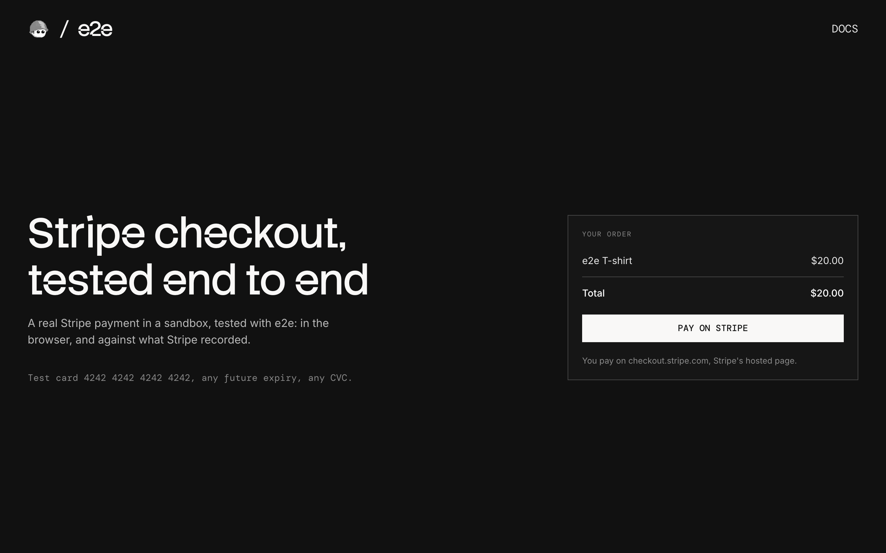

# e2e-stripe

A checkout that takes real Stripe payments in a sandbox, used as an example of end-to-end testing a payment page you don't own with [e2e](https://www.npmjs.com/package/e2e).



## How it works

The checkout uses Stripe's hosted page, the flow Stripe recommends:

- **Checkout** (`app/page.tsx`) shows the order and a Pay on Stripe button.
- **`POST /checkout`** (`app/checkout/route.ts`) creates a Stripe Checkout Session and redirects to `checkout.stripe.com`.
- **Return page** (`app/return/page.tsx`) asks Stripe whether the session is paid and shows the result.

The amount comes from the server, and the return page checks with Stripe instead of trusting the URL. There is no Stripe.js and no database: the Checkout Session is the only state.

### Test cards

| Card number           | Result             |
| --------------------- | ------------------ |
| `4242 4242 4242 4242` | Paid               |
| `4000 0000 0000 0002` | Declined           |
| `4000 0027 6000 3184` | Asks for 3D Secure |
| `4000 0025 0000 3155` | Asks for 3D Secure |

Use any future expiry date and any CVC.

## Getting started

```bash
npm install
npm run dev
```

Open [http://localhost:3000](http://localhost:3000).

### Stripe key

Everything runs in a free Stripe sandbox. Create one at [dashboard.stripe.com/sandboxes](https://dashboard.stripe.com/sandboxes), copy `.env.example` to `.env.local`, and set `STRIPE_SECRET_KEY` to the sandbox's secret key (`sk_test_…`) from [dashboard.stripe.com/apikeys](https://dashboard.stripe.com/apikeys).

## End-to-end tests

The tests in `tests/hosted.e2e.ts` pay on Stripe's real page: a valid card, a declined card, 3D Secure completed and failed, and backing out. They combine exact locators on our pages with `agent.act` / `agent.assert` steps on Stripe's page, then check what Stripe recorded through its API. Stripe's checkout has anti-bot protection, and Stripe [doesn't promise that test scripts can drive it](https://docs.stripe.com/automated-testing), so a failed test runs up to two more times before it counts as failed.

The agent model goes through the Vercel AI Gateway, so set `AI_GATEWAY_API_KEY` (or link a Vercel project). Then, with the dev server running:

```bash
npm run test:e2e
```

To test a different URL, set `APP_URL`. Configuration lives in `e2e.config.ts`.

## Scripts

| Command            | Description          |
| ------------------ | -------------------- |
| `npm run dev`      | Start the dev server |
| `npm run build`    | Build for production |
| `npm run lint`     | Run ESLint           |
| `npm run format`   | Format with Prettier |
| `npm run test:e2e` | Run the e2e tests    |
